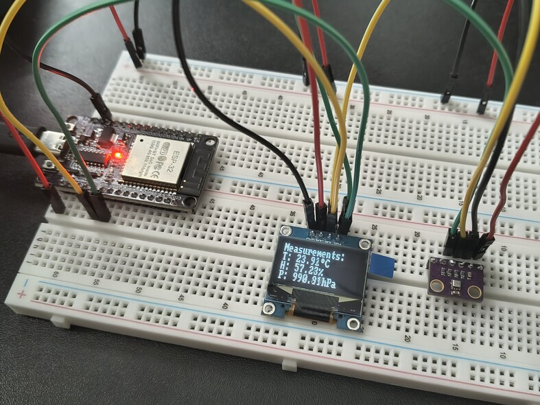
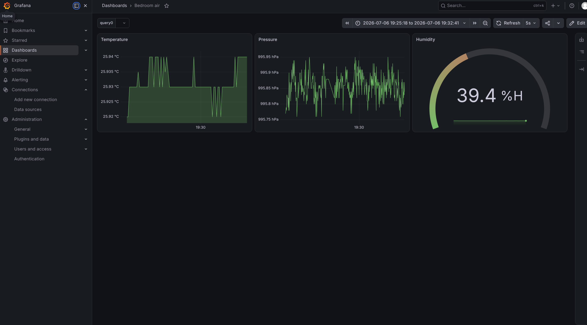
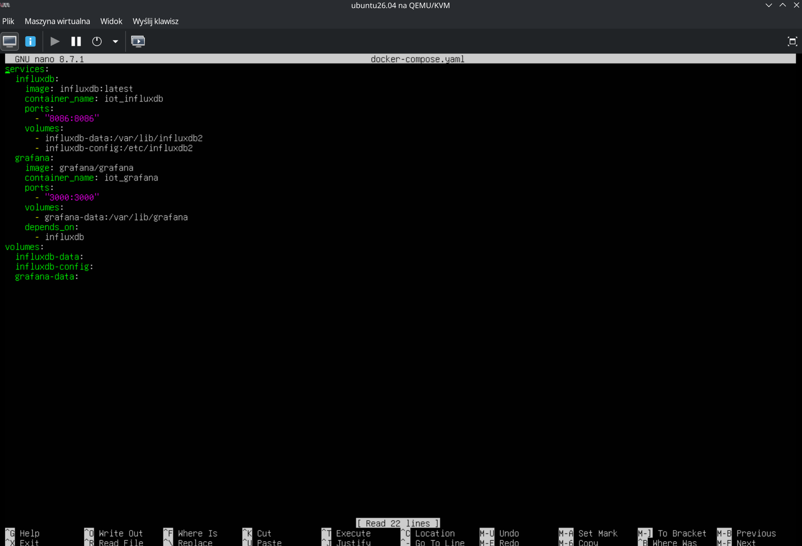

# IoT Weather Station on ESP32 (FreeRTOS + InfluxDB)
Program reads environmental data from a BME280 sensor using an I2C bus,
displays it on an OLED SSD1306 screen and sends it asynchronously to an InfluxDB database through Wi-Fi. The results are displayed on a Grafana website deployed on Docker.

## The setup:

## Grafana Webapp:
Three different graphs were chosen to display temperature, pressure and humidity data in real time.

## Dockerfile on a Ubuntu VM:
I used a Docker container hosted on a virtual machine for the convenience of a quick setup and to simulate a client-server communication.

